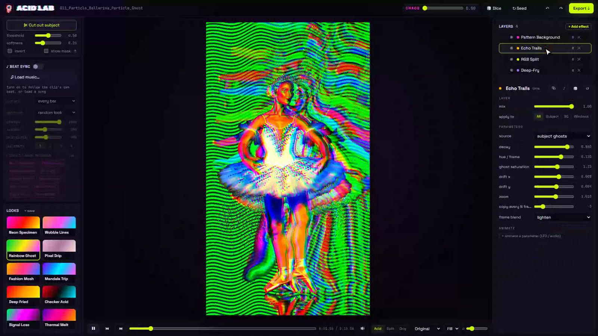

# Acid Lab

Beat-synced psychedelic looks for your clips. The subject gets one look, the world behind it another, and it all cuts
to the beat of your music. Every effect runs on the GPU with WebGL, live, and exports frame-exact at full size.

**Try it live: [mariobilly.github.io/acid-lab](https://mariobilly.github.io/acid-lab/)** (the browser edition: nothing
is uploaded, your files stay in your browser)



## Two editions

| | Desktop app (`server.py` + `web/`) | Browser edition (`browser/`) |
|---|---|---|
| Runs | on your PC: a small local Python server and a Chrome / Edge app window | in any current Chrome or Edge, nothing to install |
| Subject cut-out | **AI on the GPU** (InSPyReNet, rembg as a fallback), or an auto key | auto key (by the colour at the edges, or by brightness) |
| Beat Sync | librosa beat tracking | a lighter beat finder in the browser |
| Export | frame-exact MP4 through ffmpeg, saved to `Videos\Acid Lab` | frame-exact MP4 in the browser (WebCodecs), downloaded |

## What it does

- **Looks**: Neon Specimen, Rainbow Ghost, Pixel Drip, Fashion Mosh, Mandala Trip, Deep Fried, Checker Acid,
  Signal Loss, Thermal Melt, Wobble Lines. Each look is a stack of effect layers.
- **Effect layers**, each aimed at the subject, the background or everything:
  - Glitch: RGB split, block glitch, datamosh, pixel sort, pixel drip / melt, scanline tear, censor blocks, VHS
  - Color: acid hue cycle, posterize, solarize / invert, gradient map, deep-fry
  - Distort: liquid warp, kaleidoscope / mirror, feedback tunnel, wave / swirl
  - Time: echo trails, time-slice, stutter / strobe
  - Subject: pattern background, neon halo
  - Finish: edge neon, bloom, grain / vignette
- **Chaos** pushes every effect further, and the **dice** roll a whole new stack.
- **Beat Sync**: load a song and Acid Lab finds the tempo. On every bar or beat it cuts to a new look, picked from the
  ones you choose, and the song becomes the soundtrack of the export.
- Save your own looks, and save stills as PNG.

## Run the desktop app

You need Windows, [Python](https://www.python.org) 3.11 or newer, [ffmpeg](https://ffmpeg.org) on your PATH, and
Chrome or Edge. An NVIDIA GPU makes the AI cut-out fast; without one it runs on the CPU, slowly.

```bash
git clone https://github.com/mariobilly/acid-lab.git
cd acid-lab
pip install torch --index-url https://download.pytorch.org/whl/cu128   # GPU build of PyTorch (skip for CPU only)
pip install -r requirements.txt
pythonw launch.pyw
```

`launch.pyw` starts the local server on `127.0.0.1:47833` and opens the app window. Run it again with a file path (or
drop a video onto a shortcut to it) to open that file. The server stops by itself when you close the window.
The first AI cut-out downloads the InSPyReNet model weights once.

Your saved looks and the app's working files are kept in `%LOCALAPPDATA%\AcidLab`.

## Run the browser edition locally

The `browser/` folder is plain static files. Serve it with any web server, for example:

```bash
cd browser
python -m http.server 8000      # then open http://localhost:8000
```

## Credits

- [mp4-muxer](https://github.com/Vanilagy/mp4-muxer) by Vanilagy (MIT), for the browser edition's export.
- AI cut-out: [transparent-background](https://github.com/plemeri/transparent-background) (InSPyReNet, MIT) and
  [rembg](https://github.com/danielgatis/rembg) (MIT).

## Licence

MIT, see [LICENSE](LICENSE).
